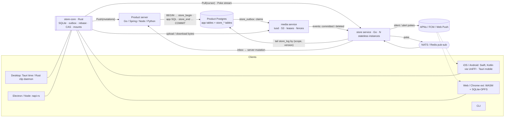

# Store Service Architecture

**Offline-first sync of records and files for skkil products**

Scope legend: **[BUILD]** = v1, needed to ship `clip` and `time` ·
**[THESIS]** = built and evaluated as the graduation-thesis section ·
**[DESIGN]** = schema and interfaces exist, not implemented in v1

Related documents:

- [`reports/Local first sync engine research.md`](reports/Local%20first%20sync%20engine%20research.md):
  design space, case studies for `clip` and `time`, folder mounts, E2EE modes
- [`reports/Sync engine thesis novelty check.md`](reports/Sync%20engine%20thesis%20novelty%20check.md):
  prior art, claim verdicts, distributed-server rules, literature map (Appendix A)
- [`reports/Sync framework shipping plan.md`](reports/Sync%20framework%20shipping%20plan.md):
  mobile, notifications, telemetry, build vs. buy, 8-week plan, thesis evaluation
- [`../ARCHITECTURE.md`](../ARCHITECTURE.md): the media service, which `store` uses for all file bytes

---

## 0. Summary

`store` keeps app records consistent between local SQLite on every device and the
product's Postgres. It does this while devices go offline, retry, crash and get
rejected. It has three parts:

1. **`store-core`**, a Rust client library. It is embedded in every client through
   platform bindings.
2. **The write path**, a set of Postgres functions and triggers. Each product server
   calls them *inside its own transaction*, in any language.
3. **The `store` service**, a stateless Go microservice. It reads the committed log
   and serves pull, poke and push to clients.

File bytes never go through `store`. They go to the **media service**, and `store`
tracks references to them.

Rows and the log are written in one transaction, so structurally this is a
**transactional outbox that never empties**. `store_log` is retained and has a
dense order per scope, and clients read it directly by cursor.

---

## 1. Goals and non-goals

**Goals**

- Offline reads and writes on desktop, mobile, web and the CLI. Writes become
  *named mutations* that commit atomically on the server.
- One reusable sync layer for every skkil product. Each product writes only its
  schema, its mutation handlers and its merge declarations.
- The product keeps its own Postgres and business rules. `store` attaches to the
  product's database; it does not replace it.
- Any server language. The contract is the wire protocol, the Postgres functions and
  a conformance suite.
- Correctness that can be stated and tested (§17), with load and benchmark evidence (§19).

**Non-goals (v1)**

- Real-time collaborative text (CRDT live mode) [DESIGN].
- Peer-to-peer sync without a server.
- E2EE mode [DESIGN, v1.1] (§12).
- Folder mounts on mobile.
- Being a general-purpose public product.

---

## 2. Design principles

1. **The single-transaction rule.** A mutation's app-row changes, the scope's version
   increment and the idempotency record commit in **one Postgres transaction, on one
   shard**. Nothing else is allowed to decide order.
2. **One ordered source per scope; everything downstream is disposable.** This
   covers the `store` service instances, caches, the poke bus, push providers and
   Kafka. Any of them can be stale, lossy or duplicated, because clients always
   recover by pulling from the log by cursor.
3. **Push is a poke, never the data.** This holds for APNs, FCM, Web Push, WebSocket
   and SSE alike.
4. **Intent on the wire, rows in the log.** Clients send named mutations (`clip.create`,
   `task.move`). The server runs them and logs the resulting row patches. Clients apply
   the patches and then rebase their pending mutations on top.
5. **Bytes are immutable and content-addressed.** Records hold references. Conflicts
   happen only on references, never on bytes.
6. **Telemetry never rides the sync log** (§16).
7. **The protocol is the contract** (§5, §14). The Go server is only the reference
   implementation.

---

## 3. Components



| Component | Language | Role | Scope |
|---|---|---|---|
| `store-core` | Rust | Local SQLite, outbox, cursor, rebase, CAS blob store, file reference states, telemetry spool, folder mounts | [BUILD]; mounts [THESIS] |
| Bindings | UniFFI (Swift/Kotlin), napi-rs (Node/Electron), wasm-bindgen (web), uniffi-bindgen-react-native / flutter_rust_bridge | Expose `store-core` to each platform | [BUILD] for the platforms in v1 |
| Write path | PL/pgSQL functions + triggers (`store_*`) | Sequencer, idempotency, patch capture, hash chain, rejection records | [BUILD] |
| Server adapter | Go package `store` (reference); thin adapters for Spring/Node/Python | Push handler, mutation registry, calls the write-path functions | Go [BUILD], others [DESIGN] |
| Validator | Rust compiled to WASM | Deterministic business-rule checks, run by the server (standard mode) and by clients (E2EE replay) | [BUILD] for `time`'s structural rules |
| `store` service | Go | Pull, poke stream, scope routing, push-provider fan-out, inbox for media events, sync-health metrics | [BUILD] |
| Poke bus | NATS core or Redis pub/sub | "Scope X is at version N", at most once | [BUILD] |
| media service | Go (existing design) | Bytes, leases, claims, fences, reclamation | [BUILD] per `../ARCHITECTURE.md` |

---

## 4. Data model

### 4.1 Contract for every synced app table

Every table a product wants synced follows this column contract:

| Column | Type | Notes |
|---|---|---|
| `id` | `uuid` (UUIDv7) or a content hash | Generated on the client. No server sequences. |
| `scope_id` | `uuid` | The ordering and sync unit: one user for personal data, or later one workspace |
| `version` | `bigint` | Set by a trigger to the scope version that last changed the row |
| `deleted_at` | `timestamptz NULL` | Tombstone. Hard deletes are not synced. |
| `hlc` | `bigint NULL` | Only on fields declared as LWW-by-HLC (§11) |
| ordering fields | `text` | Fractional index keys (`order_key`). No dense integer positions. |

Migration notes for existing code (from the case studies):

- `time` uses `INTEGER PRIMARY KEY` and dense `position`. It needs UUIDv7 IDs and an
  `order_key`, and the existing `time.db` must be migrated on first launch.
- `clip` uses `gen_random_uuid()` on the server. Change this to a client-side
  `HMAC(user_key, normalized content)`, so the same copy on two devices dedups by
  identity.

### 4.2 Server tables (in each product's Postgres)

```sql
CREATE TABLE store_scope (
  scope_id     uuid PRIMARY KEY,
  epoch        int    NOT NULL DEFAULT 1,      -- bumped on restore, failover or shard move
  head_version bigint NOT NULL DEFAULT 0,      -- the sequencer
  head_hash    bytea  NOT NULL DEFAULT '\x00', -- hash-chain tip
  retained_from bigint NOT NULL DEFAULT 0      -- log entries below this are compacted into snapshots
);

CREATE TABLE store_client (
  client_id        uuid PRIMARY KEY,           -- one per device install
  scope_id         uuid NOT NULL REFERENCES store_scope,
  last_mutation_id bigint NOT NULL DEFAULT 0,  -- idempotency (Replicache rule)
  last_seen_at     timestamptz NOT NULL DEFAULT now()
);

CREATE TABLE store_log (
  scope_id    uuid   NOT NULL,
  version     bigint NOT NULL,
  seq         int    NOT NULL,                 -- order of patches within one mutation
  kind        text   NOT NULL,                 -- 'patch' | 'rejection' | 'mutation' (E2EE)
  table_name  text,
  row_id      uuid,
  op          text,                            -- 'upsert' | 'delete'
  data        jsonb,                           -- row image ('patch'), reason ('rejection')
  payload     bytea,                           -- ciphertext ('mutation', E2EE mode only)
  client_id   uuid   NOT NULL,
  mutation_id bigint NOT NULL,
  hash        bytea,                           -- set on seq = 0: chain hash of this version
  committed_at timestamptz NOT NULL DEFAULT now(),
  PRIMARY KEY (scope_id, version, seq)
);

CREATE TABLE store_snapshot (                  -- for compaction and new devices
  scope_id uuid, version bigint, object_key text, hash bytea,
  PRIMARY KEY (scope_id, version)
);

CREATE TABLE store_outbox (                    -- classic outbox to the media service
  id bigserial PRIMARY KEY, scope_id uuid, version bigint,
  kind text,                                   -- 'claim' | 'release'
  media_id uuid, created_at timestamptz DEFAULT now()
);
```

### 4.3 Client tables (in `store-core`'s SQLite)

| Table | Purpose |
|---|---|
| app tables | Mirror of the server's synced tables, plus local-only columns |
| `pending_mutation(mutation_id, name, args, created_at, status)` | Outbox of named mutations. It is written in the same SQLite transaction as the optimistic row changes. |
| `sync_state(scope_id, epoch, version, hash)` | The cursor |
| `blob(hash, size, mime, state, local_path)` | CAS index. `state` is `local` / `uploading` / `committed` / `evicted`. |
| `blob_ref(row_table, row_id, field, hash, ref_state)` | Reference state: `pending` → `committed` → `revoked` |
| `sync_issue(mutation_id, reason, rows)` | Rejected mutations shown to the user |
| `fs_entry(...)` | Folder mount merge base (§10) [THESIS] |

The telemetry spool lives in a **separate SQLite file** (§16).

---

## 5. Wire protocol (connect-rpc / protobuf)

```proto
service Store {
  rpc Push(PushRequest)  returns (PushResponse);          // client → product server (or proxied by store)
  rpc Pull(PullRequest)  returns (PullResponse);          // client → store service
  rpc Pokes(PokeRequest) returns (stream Poke);           // client → store service, foreground only
}

message Mutation   { uint64 mutation_id = 1; string name = 2; bytes args = 3; int64 hlc = 4;
                     string traceparent = 5; }
message PushRequest  { string client_id = 1; string scope_id = 2; repeated Mutation mutations = 3;
                       uint32 schema_version = 4; }
message MutationResult { uint64 mutation_id = 1;
                         enum Status { APPLIED = 0; DUPLICATE = 1; REJECTED = 2; REWRITTEN = 3; } Status status = 2;
                         string reason = 3; uint64 version = 4; }
message PushResponse { repeated MutationResult results = 1; }

message Cursor     { uint32 epoch = 1; string scope_id = 2; uint64 version = 3; bytes hash = 4; }
message PullRequest  { string client_id = 1; Cursor cursor = 2; uint64 min_version = 3; uint32 limit = 4; }
message PullResponse {
  oneof body { Entries entries = 1; Snapshot snapshot = 2; Reset reset = 3; }
  uint64 last_mutation_id = 4;  // the server's ack for this client's pending mutations
}
message Poke { string scope_id = 1; uint64 version = 2; }
```

Rules:

- **Push always answers 2xx with a status per mutation.** A rejection is data, not a
  transport error, because a transport error would block the whole queue (the
  PowerSync lesson).
- **Pull is idempotent and resumable.** `min_version` gives read-your-writes across
  instances. `Reset` is returned when the epoch or hash doesn't match; the client then
  re-fetches a snapshot and re-sends its pending mutations.
- **Pokes are hints.** Clients also pull on reconnect, on a timer and on any version
  gap.

---

## 6. Write path [BUILD]

The product server handles `Push`, in any language. For each mutation:

```sql
BEGIN;
  -- 1. lock the scope, check idempotency, open the version
  SELECT store_begin(:scope_id, :client_id, :mutation_id);
       -- returns 'duplicate' → COMMIT and report DUPLICATE
       -- otherwise: locks store_scope row (SELECT … FOR UPDATE), sets
       -- session vars store.scope / store.version = head_version + 1
  -- 2. product business logic: ordinary SQL on synced tables
  UPDATE task SET order_key = :k, parent_id = :p WHERE id = :id AND scope_id = :scope_id;
       -- trigger store_capture() appends a 'patch' row to store_log with
       -- (scope, version, seq++) and sets task.version
  -- 3. close the version: chain hash, bump head, advance last_mutation_id
  SELECT store_end();
COMMIT;
```

- **Validation** (cycles, depth, recurrence, bounded counts) runs in step 2, through the
  shared WASM validator. When it fails, the server rolls back to a savepoint and calls
  `store_reject(scope, client, mutation_id, reason)`. That function advances
  `last_mutation_id` and appends a durable `rejection` entry to the log, so every
  device learns about it.
- **Hash chain**:
  `h_v = SHA-256(h_{v-1} ‖ v ‖ client_id ‖ mutation_id ‖ SHA-256(patches_v ordered by seq))`.
  It is computed in `store_end()` and stored on `seq = 0` and in `store_scope.head_hash`.
- **Lock hold time.** The scope row is locked from `store_begin` to `COMMIT`. With
  per-user scopes the contention is one user's own devices, which is acceptable. For
  shared workspaces later, move the lock to the end of the transaction [DESIGN].
- **Do not use** `bigserial`, Redis `INCR` or Kafka offsets for ordering. Sequences
  commit out of order, and a cursor-based pull then skips rows.
- **After commit**, the product sends `NOTIFY store_poke, '<scope>:<version>'` or
  calls the `store` service, so pokes go out without waiting for a poll.

Because the rules live in Postgres functions, a Spring `@Transactional` method, a Node
`pg` transaction or a Python `psycopg` transaction just call the same three functions.

---

## 7. Read path: the `store` service [BUILD]

- **Stateless instances.** Any instance can serve any pull. Routing by `scope_id`
  (consistent hashing) is only a cache-locality hint.
- **Pull**: `SELECT … FROM store_log WHERE scope_id = $1 AND version > $2 ORDER BY version, seq LIMIT $3`.
  Within a scope, versions are dense and commit-ordered thanks to the scope-row lock,
  so this never skips a row. If `version < retained_from`, the service returns a
  `Snapshot` (the object in the media service, with its hash) and then the entries.
- **Read replicas** may serve a pull only once their replay LSN has passed the
  version the client asked for (`min_version`). Otherwise the pull goes to the primary.
- **Caches** hold only immutable things: log entries keyed by `(scope, version)`,
  snapshots at a version, and "head is at least N" hints. **No cache-aside of current
  rows on the pull path**, because a stale row paired with a newer cursor causes
  permanent divergence.
- **Cross-scope consumers** (search indexer, analytics, the media relay) read in
  commit order using an `xid8` + `pg_snapshot_xmin` watermark, never `id > last_id`.
- **Inbox**: media events (`committed`, `deleted{reason}`) are deduplicated by event
  ID and turned into server mutations through the product's write path. File reference
  states therefore change through the log like everything else.

---

## 8. Notifications and event streams [BUILD]

| Channel | Use | Notes |
|---|---|---|
| connect-rpc server stream (`Pokes`) | Foreground clients: desktop, web, extension, open mobile apps | Reconnect with backoff, then pull |
| NATS core / Redis pub/sub | Pokes between `store` instances | At most once. Gaps are recovered by pull. |
| APNs background / FCM data messages | Wake a backgrounded mobile app | About 2–3 an hour on iOS, may be dropped. Never contains user data. |
| APNs alert + Notification Service Extension | User-visible notification (E2EE later) | Generic text plus an ID; decrypted on the device |
| Local notifications | `time` reminders | Scheduled on each device from synced data. Rolling window of 64 on iOS. Exact-alarm permission on Android. "Dismiss" is a synced mutation. |
| Web Push (`userVisibleOnly:false`) | Chrome extension | Chrome 121+ |
| Kafka | Service-to-service only, later | Fed from outboxes as an extra sink. Never on the client path. |

Google Calendar (`time`, later) is another poke-then-pull source: watch-channel
notification → `syncToken` pull → inbox → mutations. On 410, run a full resync.

---

## 9. Files and the media service [BUILD]

1. **Capture**: `store-core` writes the bytes to `blobs/tmp`, fsyncs, renames to
   `blobs/sha256/<hash>`, then commits the row + `blob_ref(pending)` +
   `pending_mutation` in one SQLite transaction. A startup reconciler removes
   unreferenced files and re-fetches missing ones.
2. **Upload**: through the media service (tus / S3 multipart, resumable). On iOS this
   uses a background `URLSession` per chunk; on Android, WorkManager or user-initiated
   data-transfer jobs.
3. **Reference**: the mutation that references a file can be pushed before the upload
   finishes. The write path writes a `claim` to `store_outbox`. Other devices see the
   reference as `pending` and render a placeholder.
4. **Commit**: the media service's `committed` event goes through the inbox → a
   mutation → `ref_state = committed` in the log.
5. **Rejection or delete**: a rejected mutation or a tombstone produces a `release` in
   `store_outbox`. The media service reclaims the bytes once all claims are gone *and*
   all device leases have expired (S5). `deleted{reason}` propagates as
   `ref_state = revoked`, and devices evict their cached copies.

Dedup is per user: hash plaintext in standard mode, and use a keyed hash in E2EE mode.

---

## 10. Folder mounts [THESIS, desktop only]

A *mount* binds a user folder to a table through a codec. **Opaque** codecs map one
file to one row plus one blob (e.g. `clip` screenshots). **Structured** codecs map one
file to many rows (e.g. `time` Markdown task lists). Per-file state in
`fs_entry(path, path_key, inode, size, mtime_ns, observed_hash, synced_hash, synced_row_version, codec_complement)`
serves as the merge base.

- **Inbound**: the watcher is only a hint; a scan is the truth. The engine suppresses
  echoes of its own writes, detects moves, decodes the file, diffs it against the base
  and emits mutations. All of that commits in one SQLite transaction.
- **Outbound**: render the file. If disk still equals `synced_hash`, record the write
  intent, write temp → fsync → rename, and commit. Otherwise, run a three-way merge:
  per-field row merge for structured files, or a conflict copy for opaque files.
- **Laws F1–F5**: PutGet, GetPut, no lost update, crash recovery, echo freedom.

Full design: `reports/Local first sync engine research.md`, section "Two-way
filesystem ↔ database sync".

---

## 11. Merge rules and conflicts

| Declaration | Options | Examples |
|---|---|---|
| Field merge | `server` (the server order decides; the default), `lww_hlc`, `max`, `counter`, `set`, `crdt` [DESIGN] | `clip.last_copied_at: max`; `task.title: server` |
| Ordering | `order_key` (fractional index), with a server-side tiebreak | `task`, `section`, `project` |
| Tree moves | Server-validated: no cycles, max depth | `task.parent_id`, `project.parent_id` |
| Soft invariants | Accept the merge and raise a `sync_issue` instead of rejecting | `time`: 3 musts per day, 3 open outcomes per week |
| Hard invariants | Reject the mutation (`store_reject`) | Cycles, recurrence without a due date |
| Idempotent commands | Keyed by occurrence | `task.complete(task_id, occurrence_date)` |
| Device-local state | `scope: device`, never synced | UI preferences, `running_timer` per device |
| Derived state | Not synced, recomputed locally | Weather, blocked state, virtual recurrences |

Collaboration later: rich text becomes a `crdt` field (Yjs or Loro). Its live mode
uses one actor per document and posts only a coarse "document advanced" mutation into
the log [DESIGN].

---

## 12. E2EE mode [DESIGN, v1.1]

- Opt-in per user. The same protocol is used, with a different trust placement.
- The server stores `kind = 'mutation'` entries holding ciphertext `payload`. It still
  orders them per scope, chains their hashes, and checks metadata only: idempotency,
  quotas, claims and leases.
- Clients replay the ordered log through the **same WASM validator** and reach
  identical accept/reject decisions (S6). In standard mode clients also replay, as a
  self-check.
- Features that need plaintext on the server are disabled, run by a designated device,
  or granted a key for one scope only. That includes Google Calendar mirroring and
  server search.
- Switching modes is a log migration at a cut point (snapshot + epoch bump), not a
  second protocol.
- Prior art to cite: SPORC, Encrypted Spaces, Acumen, SignalCD (see the novelty check).

---

## 13. Client platforms

| Platform | Binding | Local store | Notes |
|---|---|---|---|
| Tauri desktop (`time`) | direct Rust | SQLite (WAL) | Mounts available |
| Rust daemon (`clip` desktop) | direct Rust | SQLite | Screenshot mount |
| iOS / Android native (`clip`) | UniFFI → Swift / Kotlin | bundled SQLite | No background clipboard reads: capture via share sheet, `UIPasteControl` or a Quick Settings tile. Do not keep the live DB in an App Group; extensions write inbox files instead. |
| Tauri mobile (`time`) | direct Rust | SQLite | Go/no-go spike in week 1 |
| React Native / Flutter | uniffi-bindgen-react-native / flutter_rust_bridge | SQLite | [DESIGN] |
| Electron / Node | napi-rs | native SQLite | Mounts available [DESIGN] |
| Web app | wasm-bindgen | SQLite-WASM on OPFS in a worker | One writer tab (Web Locks); `navigator.storage.persist()`; no mounts |
| Chrome extension | WASM in an offscreen document, or online-only in v1 | OPFS | Web Push for pokes |
| Go CLI | online client in v1 | — | uniffi-bindgen-go later [DESIGN] |

**Keys**: Keychain (`AfterFirstUnlockThisDeviceOnly`) or Android Keystore, plus a
recovery code. Keys are not bound to biometrics, because that would block background
sync.

---

## 14. Server languages

| Layer | Go (reference) | Spring Boot / Kotlin | Node | Python |
|---|---|---|---|---|
| Write path | `store` package calling `store_begin/end/reject` | `@Transactional` + JDBC/jOOQ calls | `pg` transaction | `psycopg` transaction |
| Validator | wasmtime-go | Chicory / wasmtime-java | built-in WASM | wasmtime-py |
| Read path | the `store` service, shared, language-independent | same | same | same |

A server implementation is correct only if it passes the **conformance suite**: the
simulator and its checks, run over the wire protocol (§19). For v1, build only the Go
adapter.

---

## 15. Distribution and scaling

- **Shards**: logical shards keyed by `scope_id`, many more than physical Postgres
  hosts. A shard moves by copying, catching up on the log, bumping the epoch as a fence,
  and then flipping routing.
- **Failover and restore**: async promotion or point-in-time restore bumps the epoch,
  and the hash chain makes any rewind visible. Use synchronous replication where client
  rewinds are unacceptable. Backups must restore `store_log` and the media claims to a
  consistent cut.
- **Instances**: `store` service instances scale horizontally behind a load balancer.
  WebSocket/stream connections are spread across instances and receive pokes through
  the bus.
- **Throughput bound**: one sequencer row per scope. This is fine for personal scopes;
  measure it with pgbench before allowing shared workspaces.

---

## 16. Telemetry and observability

- **Separate spool**: its own SQLite file, size-capped, drops oldest, opt-in, lowest
  network priority. It is never written to `pending_mutation` or `store_log`.
- **Never collected**: clip content, window titles, task text. A CI test asserts this.
- **SDKs**: OpenTelemetry on mobile (disk buffering) and the server; Sentry for crashes
  (opt-in); a hand-built spool for the Rust desktop app and the extension.
- **Sync-health metrics**: outbox depth and oldest age, push latency, convergence time,
  rejection rate, `sync_issue` count, pull lag, blob upload backlog, orphan bytes,
  reclaim lag, poke-to-pull latency, reconnect storms, clock skew, dropped telemetry.
- **Tracing**: `traceparent` is stored on each mutation, so a trace can be linked across
  the offline gap.
- **Privacy**: disclose overseas processors under PIPA, fill in the store privacy
  forms, and prefer a self-hosted collector.

---

## 17. Invariants

| ID | Invariant |
|---|---|
| D1 | All invariants below hold under N stateless `store` instances, a lossy poke bus, immutable caches, replica lag, shard moves and failover (with an epoch bump) |
| L1 | Versions are dense and gap-free per scope, and monotonic for each client's pulls |
| L2 | Each `(client_id, mutation_id)` is applied at most once |
| L3 | A client never observes part of a mutation (atomic visibility per version) |
| L4 | Every device that has processed the same `(epoch, version, hash)` prefix holds identical synced state (S4; S6 once E2EE exists) |
| S1 | After convergence there is no file reference without bytes. Uncommitted references are visible as `pending`. |
| S2 | A rejected mutation leaves no orphan file and is visible to every device as a durable rejection entry |
| S5 | Bytes are not reclaimed while any claim or unexpired device lease exists |
| F1–F5 | Folder-mount laws [THESIS] |
| T1 | Telemetry never contains user content and never shares a queue with user mutations |

---

## 18. Failure matrix (abridged)

| Failure | Behavior |
|---|---|
| Push request lost or retried | Idempotent via `last_mutation_id` → `DUPLICATE` |
| Product server crashes mid-transaction | Rolls back; the client retries |
| `store` instance dies | Stateless; clients reconnect elsewhere and pull from their cursor |
| Poke lost | Timer or reconnect pull recovers it |
| Read replica lag | `min_version` sends the pull to the primary |
| DB restore or failover rewinds the log | Epoch bump + hash mismatch → `Reset` → snapshot + re-push |
| Upload never finishes | Reference stays `pending`; the lease expires; S1 holds and others see a placeholder |
| Mutation rejected after its upload | `release` claim → reclaim after the leases expire (S5) |
| Device offline for weeks | Pull falls below `retained_from` → snapshot, then the log |
| Clock skew between devices | Order comes from the server version; the HLC is used only for declared LWW fields |

---

## 19. Testing and evaluation

- **Deterministic simulator** (seeded): N clients, offline windows, partitions, server
  crashes, replica lag, poke loss, shard moves, rejections, late uploads. It checks
  L1–L4, S1, S2, S5 and D1, and (with LazyFS crash injection) F1–F5.
- **Conformance suite**: the simulator runs over the wire protocol against any server
  implementation.
- **Load tests**: k6 with arrival-rate executors (push/pull/streams) and a custom Go
  fleet simulator (offline devices, outbox build-up, reconnect storms). pgbench custom
  scripts measure sequencer throughput.
- **Measurement rules**: open workload model, coordinated-omission-safe latencies,
  p50/p99/p99.9 with sample counts, at least 5 trials with bootstrap confidence
  intervals, controlled environment (Hoefler & Belli).
- **Ablations**: `bigserial` vs. scope-row sequencer; cache-aside vs. log pull; poke
  loss with and without periodic pull; idempotency in Redis vs. in the DB. Each should
  show measurable invariant violations.

Detailed plans are in `reports/Sync framework shipping plan.md` (thesis section).

---

## 20. Scope and phases

| Phase | Content |
|---|---|
| v1 (8 weeks) | `store-core` (SQLite, outbox, pull, CAS, file references); write-path functions; Go adapter; `store` service (pull, pokes, APNs/FCM); media integration; `clip` on desktop, extension, CLI and Android; `time` on desktop, iOS and Android via Tauri; telemetry spool; sync-health metrics |
| v1.1 | E2EE mode; `clip` iOS; widgets and keyboard; Google Calendar import/mirroring; payments if deferred |
| Thesis (to about March 2027) | Folder mounts F1–F5 (opaque, then structured codec); simulator + conformance suite; load and benchmark chapter on the `store` service |
| Later [DESIGN] | CRDT live documents; workspaces/collaboration; other server-language adapters; web app; partial sync beyond per-user scopes; branching and time travel |

---

## 21. Open decisions

1. Push endpoint placement: clients push to the product server directly, or `store`
   proxies push to the product (one endpoint for clients, one more hop).
2. Whether `store` reads product databases directly or through read replicas, and how
   the `store_*` schema is versioned as an API.
3. NATS vs. Redis for the poke bus (Redis already exists in the media service).
4. Snapshot format and retention window (`retained_from` policy).
5. When to move the scope lock to the end of the transaction (needed for shared
   workspaces).
6. Tauri mobile vs. React Native for `time` (week-1 go/no-go).
7. Thesis section confirmation with the advisor: folder mounts as the novelty, the
   `store` service as the load and benchmark subject.
